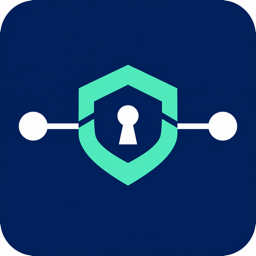

# MonixOne.OidcProxy.Yarp

BFF для SPA на .NET 10: ASP.NET Core OpenID Connect, YARP и Redis.
OAuth-токены хранятся в зашифрованных серверных сессиях; браузер получает HttpOnly cookie.
Native API, их JWT policies и балансировка работают в том же GW.

Обычный вход выдаёт сессионную cookie и сохраняет прежние idle/absolute лимиты.
Для явного «Запомнить» SPA передаёт `rememberMe=true` в `/.auth/login` вместе с
локальным `returnUrl`. Стандартный защищённый OIDC state сохраняет выбор до callback.
Постоянная cookie и зашифрованная Redis-сессия по умолчанию действуют 30 дней без
более короткого idle-лимита; refresh и активность этот срок не продлевают.
Срок настраивается через `Bff:Clients:<client>:RememberedSessionTimeout`.
Logout, отзыв доступа и истечение refresh token могут завершить вход раньше.

```csharp
builder.Services.AddOidcProxy(builder.Configuration);
// После builder.Build():
app.UseOidcProxy();
```

В существующем GW observability, CORS и rate limiting подключаются через callback
`UseOidcProxy(pipeline => …)`. Пакет регистрирует YARP и middleware один раз;
без профилей SPA сохраняет native pipeline.

Cookie bridge использует `__Host-Http-`, `Path=/`, Secure/HttpOnly и отсутствие Domain.
Backend Path проверяется сервером. Дополнительная конфигурация GW для cookie bridge
не требуется.

Сессии защищает ASP.NET Core Data Protection с общим зашифрованным key ring в Redis.
Framework управляет ротацией ключей данных. `Bff:EncryptionKey` защищает key ring;
host может вместо него использовать стандартные `ProtectKeysWithCertificate` и
`UnprotectKeysWithAnyCertificate`. Все реплики должны читать один key ring и иметь
доступ к ключам его расшифрования. Формат предназначен для нового внедрения; миграторов нет.

IdP может закрыть сессии подписанным POST на `/.auth/backchannel-logout` с учётом
`PathBase`. Зарегистрируйте этот URL у провайдера, поддерживающего OIDC Back-Channel
Logout. Проверяются issuer/audience/signature, время, событие и `sid`/`sub`.
Повторная доставка идемпотентна; незавершённое удаление возвращает 503 и допускает
повтор. Размеры, сроки, replay retention и размеры пакетов задаются в
`Bff:Clients:<name>:BackchannelLogout`; свойства описаны в `BackchannelLogoutOptions`.

`/.auth/me?slide=false` проверяет сессию без продления idle и refresh; прежний запрос
без параметра сохраняет поведение. Sample использует проверку без продления.
Обычная сессия ограничена `SessionIdleTimeout` и `SessionAbsoluteTimeout`.
Явный `/.auth/login?rememberMe=true` создаёт persistent cookie и сессию с фиксированным
`RememberedSessionTimeout` (по умолчанию 30 дней); activity и refresh срок не продлевают.
`ClientCredentialStyle` клиента выбирает `PostBody` или `AuthorizationHeader`
одновременно для PAR, code exchange, refresh и revocation. Настраивайте OIDC через
`Events`; `EventsType` отклоняется, чтобы обязательная обработка BFF сохранялась.
Бюджеты клиента задаются через `RefreshTimeout`, `SessionStoreTimeout` и
`TokenRevocationTimeout`; HTTP timeout IdP — через стандартный
`OpenIdConnect:BackchannelTimeout`. Все сроки проверяются при старте.

Для OpenTelemetry host подписывается на Meter и ActivitySource
`MonixOne.OidcProxy.Yarp` (`OidcProxyDefaults.TelemetryName`). Метрики отражают
создание/подтверждённое удаление сессий, CAS conflicts, исходы и длительность refresh,
ожидание, недоступность сессий и ошибки revocation. Истечение Redis TTL не считается
наблюдаемым удалением. Экспорт и health checks остаются ответственностью host.

CAS предполагает сохранность подтверждённых записей Redis. Асинхронный failover
или восстановление старого backup может потерять refresh/logout; при потере
состояния эксплуатационная процедура должна закрыть прежнюю область сессий и
отозвать соответствующие grants у IdP. Уже отправленные API-запросы logout не отменяет.
Для атомарного logout ключи одного BFF-клиента используют общий hash slot Redis Cluster;
распределение между shard выполняется по client scope.

## Результат обзора Duende

Изучен [Duende products, commit 222118c7](https://github.com/DuendeSoftware/products/tree/222118c7a0563a3cb4727fae5233f7ee98676e40)
и актуальная основная ветка этой библиотеки с remembered sessions 8.2.0.
Реализованы практики, применимые к текущей архитектуре:

| Рекомендация | Реализация 9.0.0 |
| --- | --- |
| Серверные токены и штатная ротация ключей | ASP.NET Core Data Protection; общий encrypted key ring в Redis; штатная защита сертификатом поддерживается |
| Централизованное завершение сессий от IdP | Подписанный OIDC Back-Channel Logout; индексы по issuer/sub/sid; bounded atomic batches и replay marker |
| Проверка сессии без фонового продления | `/.auth/me?slide=false`; sample и BR.Admin-Identity используют этот режим |
| Единый способ аутентификации confidential client | Существующий IdentityModel для `client_secret_post` / `client_secret_basic` во всех grant endpoints, включая PAR |
| Безопасные точки расширения OIDC | Штатные events с обязательным BFF lifecycle и cleanup; credentials остаются на сервере |
| Эксплуатационная наблюдаемость | Штатные Meter/ActivitySource; таймауты, лимиты и failure semantics описаны в конфигурации |

Сохранены YARP, Redis CAS, cookie/CSRF contracts, native API и разделение SPA/шлюза.
Новых инфраструктурных сервисов или зависимостей не добавлено. Формат сессий рассчитан
на новое внедрение, без миграций. Код Duende не переносился: использованы стандартные
протоколы и уже подключённые framework/library механизмы. Подключение уведомлений IdP,
хранение сертификатов, экспорт telemetry и проверка failover Redis принадлежат окружению.

## GW за балансировщиком или Swarm ingress

Обработку `X-Forwarded-For/Proto/Host` регистрирует пакет. В GW достаточно
`AddOidcProxy(configuration)` и `UseOidcProxy(pipeline => …)`; повторные
`Configure/PostConfigure<ForwardedHeadersOptions>` и `UseForwardedHeaders()` не нужны.
Пакет восстанавливает `RemoteIpAddress`, HTTPS-схему и host до callback с rate limiting.

Для закрытого GW за доверенным шлюзом доступна опция
`ForwardedHeaders:TrustAllProxies=true`: она убирает проверку IP непосредственного
proxy и обрабатывает один последний hop (`ForwardLimit=1`) без привязки к подсетям
Swarm. Прямой недоверенный доступ к GW должен быть исключён. Без опции действует
строгий режим `KnownProxies` / `KnownIPNetworks`; `AllowedHosts`, CORS, CSRF и
аутентификация сохраняются в обоих режимах. Публикацию через ingress, реплики и
`start-first` менять не требуется.

Пример конфигурации, выбор исходного IP и граница ответственности GW/Identity —
в разделе «Как работает → GW за балансировщиком: IP и HTTPS»
[интерактивного справочника](docs/index.html#flow).

## Единый интерактивный справочник

Откройте [docs/index.html](docs/index.html) в браузере. При просмотре на GitHub скачайте
этот файл и откройте локально. Всё включено в один HTML: сервер, Node и запущенные сервисы не нужны.

- **Подключение:** генератор appsettings, код GW, callbacks, секреты, шаблоны Admin Local/Dev и несколько SPA.
- **Все настройки:** полный appsettings.json с описанием каждого параметра, единиц и ограничений.
- **Как работает:** интерактивная архитектура, вход, API, refresh, Calendar, logout и порядок middleware.
- **Маршруты:** BFF/native API, PathBase и симулятор решений GW.
- **Сессии и cookies:** Redis, реплики, отказы, ротация ключей и cookie bridge.
- **Проверка и ошибки:** самодостаточные тесты, локальный запуск, CI и диагностика.

Исходник справочника — React в [ClientApp](samples/MonixOne.OidcProxy.Yarp.SampleHost/ClientApp/src/Documentation.tsx).
Обновляйте его и пересобирайте HTML; отдельно редактировать сгенерированный файл не нужно.

```sh
cd samples/MonixOne.OidcProxy.Yarp.SampleHost/ClientApp
corepack pnpm install --frozen-lockfile
corepack pnpm docs:dev       # http://localhost:4173/docs
corepack pnpm docs:build     # обновить docs/index.html
corepack pnpm test
corepack pnpm build          # sample SPA и /docs в wwwroot
```

Node/pnpm закреплены в package.json, .NET SDK — в global.json. CI проверяет тесты,
обе сборки и актуальность HTML. Генератор не запрашивает секреты, ничего не сохраняет
и не обращается к вашим сервисам; симулятор не заменяет проверку реального окружения.

Для .NET-тестов нужны Docker и установленный Chromium Playwright. Команды установки
и браузерные сценарии находятся в разделе «Проверка и ошибки» справочника.

Готовые конфигурации BR.Admin-Identity: [appsettings](docs/examples/br-admin-identity/appsettings.json),
[ingress](docs/examples/br-admin-identity/ingress.nginx.conf),
[tenant mapping](docs/examples/br-admin-identity/identity-tenants.fragment.json).
Sample host: [Program.cs](samples/MonixOne.OidcProxy.Yarp.SampleHost/Program.cs).

Основан на [OidcProxy.Net](https://github.com/oidcproxydotnet/OidcProxy.Net).
Лицензия LGPL-3.0-only; upstream copyright сохранён.
