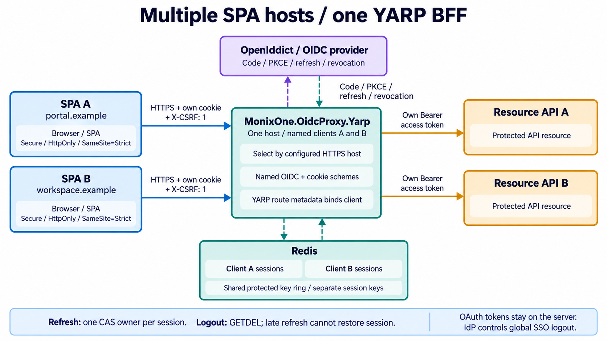
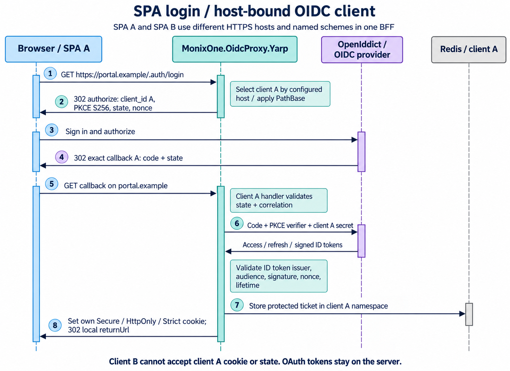

# MonixOne.OidcProxy.Yarp

[](https://github.com/Shulyakovskiy/MonixOne.OidcProxy.Yarp/actions/workflows/ci.yml)

BFF для SPA на **.NET 10 LTS**, ASP.NET Core OpenID Connect, **YARP** и Redis. Один NuGet-пакет `MonixOne.OidcProxy.Yarp`: browser получает HttpOnly session cookie, OAuth-токены остаются на сервере. Один BFF/YARP-хост обслуживает много SPA на разных публичных HTTPS-хостах, с отдельными OIDC clients и сессиями. Поддерживается стандартный confidential Authorization Code + PKCE flow, включая OpenIddict.

Репозиторий основан на [OidcProxy.Net](https://github.com/oidcproxydotnet/OidcProxy.Net). Лицензия **LGPL-3.0-only** и upstream copyright сохранены. Сервисов приложения, authorization server или UI входа пакет не реализует.

## Текущее состояние

Пакет **не опубликован**. Подготовка и проверки ведутся в этом репозитории; автоматический publish после merge отключён. BR.Admin-Identity и BR.Identity в рамках этой работы не изменялись. Цель подключения — удалить Node BFF и использовать один общий OIDC/YARP BFF, без BR-specific коннекторов.

Проверенные контракты и условия до переключения потребителя — [BR.Admin-Identity](docs/BR-ADMIN-IDENTITY.md). Перенос настроек эталонного пакета — [PACKAGE-SETTINGS.md](docs/PACKAGE-SETTINGS.md).

## Интерактивное руководство для SPA

```sh
cd samples/MonixOne.OidcProxy.Yarp.SampleHost/ClientApp
corepack pnpm install --frozen-lockfile
corepack pnpm docs:dev
```

Откройте **http://localhost:4173/docs**. Для статической документации не нужны BFF, Redis, сертификат или секреты.

- **Пошаговая настройка**: топология и публичные URL → регистрация OpenIddict/OIDC client → Redis и Data Protection → копируемые appsettings/Program.cs → React → проверка окружения. Валидация URL и namespace выполняется в браузере; параметры не сохраняются и не отправляются.
- **Как работает SPA**: интерактивные этапы login, API, refresh и logout, контракт endpoints, ответственность браузера/BFF/provider/API и ограничения при сбоях.

Документация входит в сборку sample по `/docs`. Полные команды запуска HTTPS SPA/BFF приведены в [sample README](samples/MonixOne.OidcProxy.Yarp.SampleHost/README.md).

## Пошаговая настройка

### 1. Топология и клиент провайдера

SPA и BFF должны иметь **один публичный HTTPS origin**, например `https://spa.example.com`. Resource API доступен BFF по HTTPS и самостоятельно валидирует access token. Login — обычная top-level навигация на `/.auth/login`. Параметр `returnUrl` принимает любой локальный URL, включая deep links, query и fragment; по умолчанию возвращает к корню приложения с PathBase. Logout поддерживает тот же параметр. Внешние URL, control characters и неоднозначные повторные параметры отклоняются с 400 до начала login/logout.

У провайдера зарегистрируйте confidential web client с client secret, code/refresh grants, PKCE S256 и scopes `openid profile offline_access api.read` (последний — пример scope вашего API).

| Настройка | portal | workspace |
|---|---|---|
| Client ID | `portal-bff` | `workspace-bff` |
| Redirect URI | `https://portal.example.com/.auth/login/callback` | `https://workspace.example.com/app/.auth/login/callback` |
| Post logout redirect URI | `https://portal.example.com/.auth/signout-callback` | `https://workspace.example.com/app/.auth/signout-callback` |
| Return URL по умолчанию | `/` | `/app/` |

Для **OpenIddict** нужны authorization, token, end-session и revocation endpoint permissions, code/refresh grant permissions, response type `code` и permission для API scope. Сервер включает `AllowAuthorizationCodeFlow()`, `AllowRefreshTokenFlow()` и PKCE; login/consent, claim destinations и resource assignment принадлежат authorization server. См. [application permissions](https://documentation.openiddict.com/configuration/application-permissions.html) и [официальные guides](https://documentation.openiddict.com/guides/).

Encrypted access tokens OpenIddict передаются без разбора. API должен использовать подходящую OpenIddict validation/decryption или introspection. Signed ID tokens, в том числе signed-and-encrypted при настройке стандартного `TokenDecryptionKey`, проверяются framework/IdentityModel; профиль SPA берётся из ID token, полномочия API — из access token.

### 2. Пакет и конфигурация

```sh
dotnet pack src/MonixOne.OidcProxy.Yarp/MonixOne.OidcProxy.Yarp.csproj -c Release -o artifacts/nuget
```

Эта команда создаёт локальные nupkg/snupkg. Для подключения сейчас используйте ProjectReference из этого репозитория или полученный локальный feed. Команды установки из nuget.org пока нет. Все версии зависимостей репозитория централизованы в `Directory.Packages.props`.

```json
{
  "Bff": {
    "ApplicationName": "spa-gateway",
    "KeyNamespace": "web",
    "Clients": {
      "portal": {
        "PublicOrigin": "https://portal.example.com",
        "PathBase": "",
        "SessionIdleTimeout": "00:20:00",
        "SessionAbsoluteTimeout": "08:00:00",
        "OpenIdConnect": {
          "Authority": "https://identity.example.com",
          "ClientId": "portal-bff",
          "Scope": [
            "openid",
            "profile",
            "offline_access",
            "api.read"
          ]
        }
      },
      "workspace": {
        "PublicOrigin": "https://workspace.example.com",
        "PathBase": "/app",
        "SessionIdleTimeout": "00:20:00",
        "SessionAbsoluteTimeout": "08:00:00",
        "OpenIdConnect": {
          "Authority": "https://identity.example.com",
          "ClientId": "workspace-bff",
          "Scope": [
            "openid",
            "profile",
            "offline_access",
            "api.read"
          ]
        }
      }
    }
  },
  "ReverseProxy": {
    "Routes": {
      "portal-api": {
        "ClusterId": "portal-api",
        "Match": {
          "Hosts": [
            "portal.example.com"
          ],
          "Path": "/api/{**all}"
        },
        "Metadata": {
          "OidcProxy.Client": "portal"
        }
      },
      "workspace-api": {
        "ClusterId": "workspace-api",
        "Match": {
          "Hosts": [
            "workspace.example.com"
          ],
          "Path": "/api/{**all}"
        },
        "Metadata": {
          "OidcProxy.Client": "workspace"
        }
      }
    },
    "Clusters": {
      "portal-api": {
        "Destinations": {
          "primary": {
            "Address": "https://portal-api.example.com/"
          }
        }
      },
      "workspace-api": {
        "Destinations": {
          "primary": {
            "Address": "https://workspace-api.example.com/"
          }
        }
      }
    }
  }
}
```

`Bff__Clients__portal__OpenIdConnect__ClientSecret`, `Bff__Clients__workspace__OpenIdConnect__ClientSecret` и `ConnectionStrings__Redis` передавайте через secret provider/environment. `ASPNETCORE_ENVIRONMENT` задаёт environment-сегмент Redis. Секретов в `VITE_*`, SPA bundle или исходниках быть не должно.

### 3. ASP.NET Core host

```csharp
using MonixOne.OidcProxy.Yarp;
using StackExchange.Redis;

var builder = WebApplication.CreateBuilder(args);
builder.Services.AddSingleton(sp => ConnectionMultiplexer.Connect(
    sp.GetRequiredService<IConfiguration>().GetConnectionString("Redis")
    ?? throw new InvalidOperationException("ConnectionStrings:Redis is required.")));
builder.Services.AddReverseProxy()
    .LoadFromConfig(builder.Configuration.GetRequiredSection("ReverseProxy"));
builder.Services.AddOidcProxy(bff =>
{
    builder.Configuration.GetRequiredSection("Bff").Bind(bff);
    bff.EnvironmentName = builder.Environment.EnvironmentName;
});
foreach (var section in builder.Configuration.GetRequiredSection("Bff:Clients").GetChildren())
    builder.Services.AddOidcProxyClient(section.Key,
        client => section.Bind(client),
        oidc => section.GetRequiredSection("OpenIdConnect").Bind(oidc));

var app = builder.Build();
app.Services.GetRequiredService<ConnectionMultiplexer>();
if (!app.Environment.IsDevelopment()) app.UseHsts();
app.UseHttpsRedirection();
app.UseOidcProxy();
app.UseDefaultFiles();
app.UseStaticFiles();
app.MapFallbackToFile("{**path}", "index.html").AllowAnonymous();
app.Run();
```

Для SPA под `/app` задайте `Bff:Clients:workspace:PathBase=/app` и Vite base `/app/`. Ingress сохраняет префикс до BFF. Callback URI клиента workspace: `https://workspace.example.com/app/.auth/login/callback` и `https://workspace.example.com/app/.auth/signout-callback`. Пакет выбирает клиента по точному HTTPS host/port, применяет стандартный ASP.NET Core PathBase и выбирает его именованный OIDC handler. Cookie и OIDC state защищаются разными framework-схемами; Redis sessions изолированы по имени клиента. Клиенты регистрируются при запуске; изменение состава origins/credentials требует перезапуска хоста.

`UseOidcProxy()` подключает routing/authentication/authorization, BFF endpoints и `MapReverseProxy()`. Вызывайте его до static files и других routing middleware; дополнительный MapReverseProxy не нужен. Каждый BFF route содержит `Metadata["OidcProxy.Client"]` и точный `Match.Hosts`, совпадающий с PublicOrigin authority. Wildcard/чужой host или неизвестный client отклоняются при запуске. Route на зарегистрированном SPA-хосте без client metadata получает 403. Клиент выбирается конфигурацией, query/header пользователя его не меняет.

Защищённые routes требуют cookie выбранного клиента и `X-CSRF: 1`. Дополнительные YARP authorization policies применяются штатно. Явный `AuthorizationPolicy: "anonymous"` подходит для SPA assets/public API: BFF не требует session и не передаёт OAuth token, входящие Cookie/Authorization и downstream Set-Cookie удаляются. Маршруты других хостов без BFF metadata сохраняют штатный YARP-контракт.

Match.Path и transforms задаются стандартной YARP configuration: `/api`, `/graphql` или любые другие пути/методы, без списка business endpoints в пакете. Оставьте `/.auth/*` для технических endpoints клиента. Для разных SPA bundles настройте отдельные anonymous YARP routes с нужными Hosts; локальный static-file fallback sample показывает один bundle. Fallback `{**path}` обрабатывает и deep/dotted GET/HEAD paths; API routes имеют собственный приоритет.

На ingress настройте ForwardedHeaders **до** HTTPS redirect/BFF и доверяйте только своим proxies/networks. PublicOrigin всегда указывает внешний origin браузера. Не отключайте проверку TLS downstream.

### 4. Redis и ключи

Один host-owned `ConnectionMultiplexer` используется через DI. Требуется Redis 6.2+ с GETDEL и Lua. Общий Data Protection key ring: `{application}:{environment}:{namespace}:data-protection`; sessions: `{application}:{environment}:{namespace}:{clientName}:sessions:{id}`. Имена clients уникальны, lowercase ASCII. Сегменты application/environment/namespace нормализуются в lowercase. Реплики одного BFF используют одинаковые значения; независимые приложения и окружения — разные.

В Redis хранятся защищённые tickets и общий Data Protection key ring. Хост должен обеспечить TLS/ACL, доступность, политику persistence/eviction и **независимую защиту Data Protection master keys сертификатом/KMS**, например через `AddDataProtection().ProtectKeysWithCertificate(certificate)`. Шифрование tickets не защищает от полного доступа к Redis, если master keys доступны там же без дополнительной защиты.

Восстановление старого backup может вернуть удалённые записи и старые credentials. В плане восстановления сбрасывайте область сессий и/или отзывайте grants. Memory fallback отсутствует.

### 5. SPA

```ts
// Login — навигация, не fetch.
window.location.assign("/.auth/login");

const response = await fetch("/.auth/me", {
  credentials: "same-origin",
  headers: { "X-CSRF": "1", Accept: "application/json" },
});
```

Те же headers нужны для всех proxy API, включая GET. `401` → очистить кэш пользователя и предложить вход; `403` → запрос отклонён защитой/авторизацией; `503` → временная недоступность. Не повторяйте изменяющие запросы автоматически.

Sample использует официальный **@tanstack/react-query** для cache/focus/reconnect и polling `/.auth/me` раз в 60 секунд только в видимой authenticated SPA. Polling поддерживает idle-сессию активной, но не продлевает её absolute lifetime. Anonymous/background вкладка не запускает продление по таймеру; браузер может приостанавливать таймеры. OAuth SDK и browser refresh tokens не требуются.

Logout: отменить UI query, получить `/.auth/antiforgery` с `X-CSRF: 1`, отправить native POST form с выданным framework token на `/.auth/end-session`. Это позволяет браузеру пройти redirect к провайдеру. Полный код находится в [bff.ts](samples/MonixOne.OidcProxy.Yarp.SampleHost/ClientApp/src/bff.ts).

## Как работает SPA





| Endpoint | Назначение |
|---|---|
| `GET /.auth/login` | OIDC challenge, локальный returnUrl или корень приложения |
| `GET /.auth/login/callback` | Framework state/correlation/nonce validation и обмен code |
| `GET /.auth/me` | Claims сессии, без токенов; cookie + `X-CSRF: 1` |
| `GET /.auth/antiforgery` | Framework token для logout form; cookie + `X-CSRF: 1` |
| `POST /.auth/end-session` | Локальное удаление сессии, best-effort revocation, RP logout |
| `GET /.auth/signout-callback` | Завершение logout, переход `/` |
| Настроенные YARP routes | Cookie + `X-CSRF: 1`; серверный Bearer к API |

Framework защищает session cookie; она содержит случайную ссылку, а не OAuth tokens. Cookie — `__Host-Http-oidcproxy.{clientName}.session`, Secure/HttpOnly, SameSite Strict, host-only, Path `/`. Correlation/nonce cookies используют штатные настройки для внешнего OIDC callback. Чужой Origin/Fetch-Site отклоняется. Нет CORS-контракта для другого origin SPA.

YARP удаляет входящие Cookie/Authorization, добавляет server access token и убирает downstream Set-Cookie. Destinations фиксируются конфигурацией по HTTPS, запрет на userinfo/query/fragment и отключение certificate validation. Authenticated ответы имеют `Cache-Control: no-store`. API самостоятельно проверяет issuer, audience/resource и scope/roles.

Refresh начинается за 30 секунд до истечения access token. Redis CAS сохраняет pending marker до обмена rotating credential; один владелец обслуживает конкурентные запросы/реплики. Caller disconnect не прерывает сохранение результата. Deadline — 30 секунд; refresh/code exchange не повторяются при неизвестном исходе. Отсутствие нового ID/refresh token обрабатывается по стандарту.

Logout атомарно выполняет GETDEL текущего ticket, затем очищает cookie и пытается отозвать refresh token с ограниченным таймаутом. Поздний refresh не восстанавливает удалённую запись и отзывает известный новый credential best effort. Antiforgery/logout не блокируются ожидающим refresh. Logout одного клиента удаляет только его локальную сессию; IdP может дополнительно завершать другие SSO grants по своей политике.

**Границы:** Redis и IdP не образуют общую транзакцию. Неизвестный результат refresh требует повторного входа. Logout не отменяет уже отправленный API-запрос и не обеспечивает мгновенный глобальный отзыв выданного JWT. HttpOnly не защищает от XSS-вызовов API; CSP и безопасность SPA принадлежат хосту.

Реализация следует профилю BFF из [RFC 10017](https://datatracker.ietf.org/doc/html/rfc10017) и [OAuth Security BCP](https://www.rfc-editor.org/rfc/rfc9700.html), использует стандартный [RP-initiated logout](https://openid.net/specs/openid-connect-rpinitiated-1_0.html). Это не заявление о сертификации или отсутствии всех уязвимостей.

## Состав одного пакета

| Модуль | Ответственность |
|---|---|
| Authentication | Стандартные ASP.NET Core OIDC/cookie schemes и protocol events |
| Sessions | Protected Redis tickets, CAS refresh, GETDEL logout, revocation |
| Security | Собственная BFF session, Origin/Fetch-Site и CSRF boundary |
| Endpoints | Фиксированный browser HTTP-контракт |
| Forwarding | Стандартные YARP transforms и HTTPS destination validation |

Public API и namespace: `MonixOne.OidcProxy.Yarp`; `ProxyOptions`, `OidcProxyClientOptions`, `OidcProxyDefaults`, `OidcProxyRoutes`, `AddOidcProxy`, `AddOidcProxyClient`, `UseOidcProxy`. Provider-specific packages, alternate proxy modes и общий mutable in-memory session cache удалены. OIDC настраивается штатным `OpenIdConnectOptions`, routing — штатным YARP.

## Проверка и публикация

Команды, инфраструктура тестов и проверяемые failure-сценарии описаны в [TESTING.md](docs/TESTING.md). Требуются SDK из `global.json`, Docker, Node 24.15+ и pnpm 12.16.1.

```sh
dotnet restore MonixOne.OidcProxy.Yarp.sln
dotnet build MonixOne.OidcProxy.Yarp.sln -c Release --no-restore -p:GeneratePackageOnBuild=false
dotnet test --project tests/MonixOne.OidcProxy.Yarp.Tests/MonixOne.OidcProxy.Yarp.Tests.csproj -c Release --no-build
dotnet pack src/MonixOne.OidcProxy.Yarp/MonixOne.OidcProxy.Yarp.csproj -c Release --no-build -o artifacts/nuget
```

CI проверяет пакет, HTTP/concurrency/OpenIddict тесты, SPA и документацию. Workflow `.github/workflows/publish.yml` имеет только ручной `workflow_dispatch` для main и использует environment `production`, NuGet trusted publishing и `NuGet/login`. Автоматического запуска после merge нет. Публикация не запускалась; до завершения проверки BR.Admin-Identity её выполнять нельзя. `NUGET_USER` в production уже присутствует; значение не читалось. Создайте trusted publisher в NuGet для этого репозитория/workflow/environment; настройка другого репозитория не переносится автоматически. Публикация версии необратима: повышайте Version перед следующим релизом.

### Upstream security issue

Проверено 29.10.2026: [upstream #373 — Security Issue – CVE Assigned](https://github.com/oidcproxydotnet/OidcProxy.Net/issues/373) открыт. Автор сообщает о полученном CVE, но номер, affected versions и технические детали не опубликованы в issue; публичный advisory репозитория не найден. Исправленные здесь refresh/logout ошибки подтверждены regression tests. **Утверждать, что неназванный CVE исправлен, без disclosure нельзя.**
